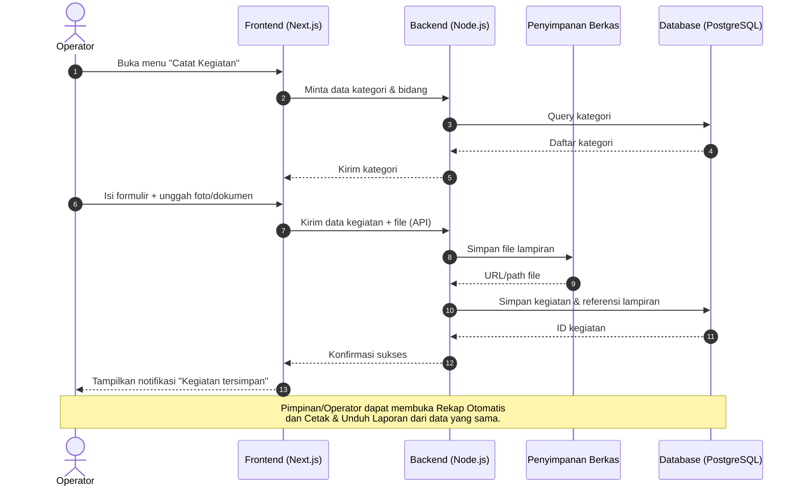
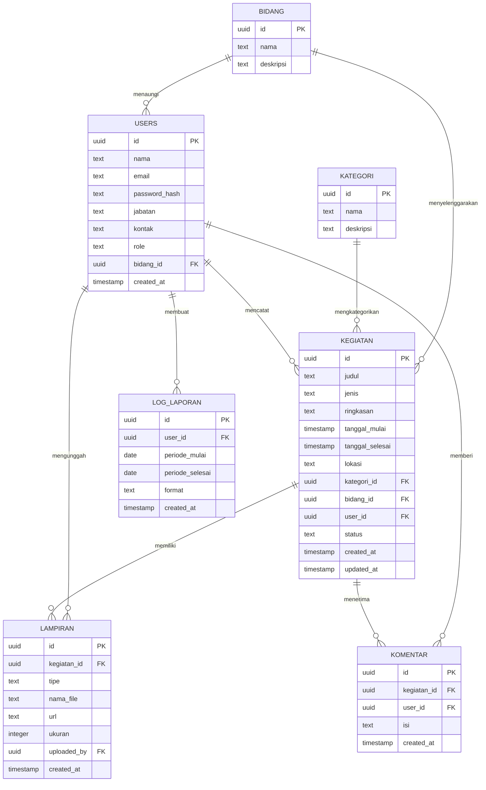

# PRD — Project Requirements Document

## 1. Overview

**Aplikasi Pendataan Kegiatan Berbasis Website pada Dinas Komunikasi dan Informatika Kota Palembang** adalah solusi digital untuk menggantikan cara pencatatan kegiatan yang selama ini tersebar di banyak tempat — mulai dari file Excel, dokumen Word, hingga percakapan WhatsApp.

**Masalah yang Diselesaikan:**
Saat ini, pegawai Diskominfo — terutama operator yang bertugas mencatat kegiatan kantor — harus berpindah-pindah aplikasi untuk menyimpan data. Akibatnya:
- Data kegiatan sulit dicari kembali karena tersebar.
- Dokumentasi (foto, surat, undangan) tidak terpusat.
- Pembuatan laporan memakan waktu lama karena harus diolah manual.
- Pimpinan tidak punya cara cepat untuk memantau kegiatan tim secara terstruktur.

**Tujuan Utama Aplikasi:**
1. Menyediakan satu tempat terpusat untuk mencatat semua kegiatan kantor.
2. Memudahkan pencarian dan pengelolaan dokumentasi kegiatan.
3. Menghasilkan rekap dan laporan secara otomatis, cepat, dan siap kirim.
4. Memberi pimpinan akses pantau kegiatan dan laporan secara rapi.

**Pemenang Pertama (First Win):**
Pengguna berhasil **mencatat kegiatan baru** melalui satu formulir cepat — tanpa perlu membuka Excel maupun WhatsApp.

---

## 2. Requirements

**Persyaratan Fungsional:**
- Pengguna dapat mencatat kegiatan kantor melalui formulir sederhana dengan waktu, lokasi, dan kategori.
- Pengguna dapat mengunggah foto dan dokumen sebagai bukti pelaksanaan kegiatan.
- Pengguna dapat mencari, menyaring, dan membuka detail kegiatan yang pernah dicatat.
- Sistem dapat menghitung rekap kegiatan (per periode, per bidang, per pegawai) secara otomatis.
- Pengguna dapat mencetak atau mengunduh laporan dalam format PDF dan Excel.
- Pimpinan dapat memantau kegiatan tim serta menandai status pemeriksaan.
- Setiap pegawai memiliki akun dan peran masing-masing (operator, pimpinan, admin).

**Persyaratan Non-Fungsional:**
- **Antarmuka mudah dipakai** bagi staf non-teknis (formulir singkat, minim klik).
- **Keamanan data**: hanya pengguna terautentikasi yang bisa mengakses data kegiatan.
- **Performa**: daftar kegiatan dan laporan tetap responsif meski data bertambah.
- **Konsistensi data**: kategori, bidang, dan format laporan seragam.
- **Dapat dijalankan di server internal** Diskominfo melalui Docker.

**Batasan:**
- Stack teknologi dikunci (Next.js, Node.js, PostgreSQL, Docker).
- Tidak direncanakan fitur di luar roadmap yang telah disetujui.

---

## 3. Core Features

Fitur di bawah ini adalah **seluruh fitur pada roadmap yang sudah disetujui**, dikelompokkan sesuai fase. Setiap sub-poin adalah detail pendukung di dalam fitur induknya.

### Fase 1 — Pondasi Pencatatan
- **Catat Kegiatan** `[prioritas: tinggi]`
  - *Formulir Cepat* — Isi nama, jenis, dan ringkasan kegiatan dalam satu layar singkat.
  - *Waktu & Lokasi* — Tentukan tanggal, jam, dan tempat kegiatan berlangsung.
  - *Pilih Kategori* — Tandai kegiatan sesuai bidang atau jenisnya agar mudah direkap.
  - *Simpan Draf* — Simpan isian sementara bila kegiatan belum selesai dicatat.

### Fase 2 — Pengelolaan & Dokumentasi
- **Daftar Kegiatan** `[prioritas: sedang]`
  - *Riwayat Kegiatan* — Lihat seluruh kegiatan terurut dari yang terbaru.
  - *Pencarian Cepat* — Cari kegiatan lewat kata kunci nama atau isi kegiatan.
  - *Filter Tanggal & Bidang* — Saring daftar berdasarkan rentang waktu atau bidang kerja.
  - *Detail Kegiatan* — Buka satu kegiatan untuk melihat isian dan lampirannya secara lengkap.

- **Bukti Foto & Dokumen** `[prioritas: tinggi]`
  - *Unggah Foto* — Tambahkan foto pelaksanaan kegiatan langsung dari perangkat.
  - *Unggah Dokumen* — Lampirkan surat, undangan, atau berkas pendukung lainnya.
  - *Pratinjau Lampiran* — Lihat sekilas foto dan dokumen tanpa perlu mengunduh dulu.
  - *Ganti & Hapus* — Perbarui atau hapus lampiran yang salah unggah.

### Fase 3 — Rekap & Pelaporan
- **Rekap Otomatis** `[prioritas: sedang]`
  - *Rekap per Periode* — Lihat jumlah kegiatan harian, bulanan, atau per tahun.
  - *Rekap per Bidang* — Bandingkan banyaknya kegiatan antar bidang atau pegawai.
  - *Ringkasan Angka* — Tampilkan total kegiatan dalam angka ringkas yang mudah dibaca.
  - *Grafik Sederhana* — Sajikan tren kegiatan dalam bentuk grafik yang cepat dipahami.

- **Cetak & Unduh Laporan** `[prioritas: tinggi]`
  - *Pilih Rentang Laporan* — Tentukan periode dan cakupan kegiatan yang ingin dilaporkan.
  - *Pratinjau Laporan* — Periksa susunan laporan sebelum dicetak atau diunduh.
  - *Unduh PDF & Excel* — Simpan laporan dalam format siap kirim atau siap olah.
  - *Cetak Langsung* — Cetak laporan langsung dari aplikasi tanpa pengaturan tambahan.

### Fase 4 — Pantau & Akun
- **Pantau Pimpinan** `[prioritas: sedang]`
  - *Ringkasan Tim* — Lihat gambaran kegiatan seluruh pegawai dalam satu layar.
  - *Filter per Pegawai* — Telusuri kegiatan berdasarkan pegawai atau bidang tertentu.
  - *Status Kegiatan* — Tandai kegiatan sudah diperiksa atau perlu perbaikan oleh pimpinan.

- **Masuk & Kelola Akun** `[prioritas: sedang]`
  - *Masuk Akun* — Login dengan akun kantor untuk membuka aplikasi.
  - *Kelola Pengguna & Peran* — Atur siapa saja yang boleh mencatat, melihat, dan memantau.
  - *Atur Profil* — Perbarui nama, jabatan, dan info kontak pemilik akun.

---

## 4. User Flow

Alur sederhana perjalanan pengguna mengikuti urutan fase pada roadmap.

**A. Operator Mencatat Kegiatan (Fase 1)**
1. Login ke aplikasi dengan akun kantor.
2. Buka menu **Catat Kegiatan**.
3. Isi formulir cepat: nama, jenis, ringkasan, waktu, lokasi, kategori.
4. (Opsional) Simpan sebagai **draf** bila belum lengkap.
5. Simpan kegiatan → data masuk ke sistem.

**B. Operator Melengkapi Bukti & Mengelola Daftar (Fase 2)**
6. Unggah **foto** dan **dokumen** pendukung ke kegiatan terkait.
7. Lakukan **pratinjau** untuk memastikan lampiran benar.
8. Buka menu **Daftar Kegiatan**, cari/filter kegiatan yang dicari.
9. Buka **Detail Kegiatan** untuk melihat isian & lampiran lengkap.

**C. Operator/Pimpinan Membuat Rekap & Laporan (Fase 3)**
10. Buka menu **Rekap Otomatis**, lihat total kegiatan per periode & bidang.
11. Periksa **grafik sederhana** untuk melihat tren.
12. Buka **Cetak & Unduh Laporan**, pilih rentang laporan.
13. Lakukan **pratinjau** → unduh sebagai **PDF/Excel** atau **cetak langsung**.

**D. Pimpinan Memantau & Admin Mengelola Akun (Fase 4)**
14. Pimpinan login → buka **Pantau Pimpinan**, lihat **ringkasan tim**.
15. Filter kegiatan per pegawai/bidang, tandai **status kegiatan** (diperiksa / perlu perbaikan).
16. Admin membuka **Masuk & Kelola Akun**, atur **pengguna & peran**.
17. Setiap pengguna dapat **mengatur profil** (nama, jabatan, kontak).

---

## 5. Architecture

Aplikasi dibangun sebagai sistem full stack dengan tiga lapisan utama:

- **Lapisan Tampilan (Frontend)** — Next.js, berkomunikasi dengan backend melalui REST API.
- **Lapisan Logika (Backend)** — Node.js yang menangani autentikasi, validasi, penyimpanan, rekap, dan pembuatan laporan.
- **Lapisan Data (Database)** — PostgreSQL untuk menyimpan data kegiatan, lampiran, pengguna, kategori, dan laporan.
- **Penyimpanan Berkas** — Foto & dokumen disimpan melalui layanan backend (volume Docker) dan direferensikan di database.
- **Deployment** — Dijalankan dalam container Docker agar mudah dipasang di server Diskominfo.

Berikut diagram alur utama saat **operator mencatat kegiatan dan mengunggah bukti**:

---

## 6. Database Schema

Berikut tabel-tabel utama yang dibutuhkan beserta kolom/field pentingnya.

**Tabel `users`** — menyimpan akun pegawai.
- `id` (UUID, PK) — identitas unik pengguna.
- `nama` (text) — nama lengkap pegawai.
- `email` (text, unik) — email/akun kantor untuk login.
- `password_hash` (text) — kata sandi terenkripsi.
- `jabatan` (text) — jabatan pegawai.
- `kontak` (text) — info kontak (telepon/WhatsApp).
- `role` (text) — peran: `operator`, `pimpinan`, `admin`.
- `bidang_id` (FK → `bidang.id`) — bidang tempat pegawai bertugas.
- `created_at` (timestamp) — waktu akun dibuat.

**Tabel `bidang`** — daftar bidang/bagian kerja di Diskominfo.
- `id` (UUID, PK) — identitas bidang.
- `nama` (text) — nama bidang.
- `deskripsi` (text) — keterangan singkat.

**Tabel `kategori`** — jenis/kategori kegiatan.
- `id` (UUID, PK) — identitas kategori.
- `nama` (text) — nama kategori (contoh: Rapat, Kunjungan, Pelatihan).
- `deskripsi` (text) — keterangan kategori.

**Tabel `kegiatan`** — data utama kegiatan yang dicatat.
- `id` (UUID, PK) — identitas kegiatan.
- `judul` (text) — nama kegiatan.
- `jenis` (text) — jenis kegiatan.
- `ringkasan` (text) — ringkasan deskripsi kegiatan.
- `tanggal_mulai` (timestamp) — waktu mulai kegiatan.
- `tanggal_selesai` (timestamp) — waktu selesai kegiatan.
- `lokasi` (text) — tempat kegiatan.
- `kategori_id` (FK → `kategori.id`) — kategori kegiatan.
- `bidang_id` (FK → `bidang.id`) — bidang penyelenggara.
- `user_id` (FK → `users.id`) — pegawai yang mencatat.
- `status` (text) — status: `draf`, `terkirim`, `diperiksa`, `perlu_perbaikan`.
- `created_at` (timestamp) — waktu dibuat.
- `updated_at` (timestamp) — waktu terakhir diperbarui.

**Tabel `lampiran`** — foto & dokumen pendukung kegiatan.
- `id` (UUID, PK) — identitas lampiran.
- `kegiatan_id` (FK → `kegiatan.id`) — kegiatan terkait.
- `tipe` (text) — `foto` atau `dokumen`.
- `nama_file` (text) — nama asli file.
- `url` (text) — lokasi penyimpanan file.
- `ukuran` (integer) — ukuran file (byte).
- `uploaded_by` (FK → `users.id`) — pengguna yang mengunggah.
- `created_at` (timestamp) — waktu unggah.

**Tabel `komentar`** — catatan pemeriksaan dari pimpinan.
- `id` (UUID, PK) — identitas komentar.
- `kegiatan_id` (FK → `kegiatan.id`) — kegiatan yang dikomentari.
- `user_id` (FK → `users.id`) — pimpinan yang memberi catatan.
- `isi` (text) — isi catatan/perbaikan.
- `created_at` (timestamp) — waktu catatan dibuat.

**Tabel `log_laporan`** — riwayat pembuatan laporan (opsional untuk audit).
- `id` (UUID, PK) — identitas log.
- `user_id` (FK → `users.id`) — pembuat laporan.
- `periode_mulai` (date) — awal rentang laporan.
- `periode_selesai` (date) — akhir rentang laporan.
- `format` (text) — `pdf` atau `excel`.
- `created_at` (timestamp) — waktu laporan dibuat.

Berikut diagram hubungan antar tabel:

---

## 7. Tech Stack

Proyek ini dibangun di atas template — codebase siap pakai yang sudah berjalan dan menyediakan fondasi lengkap. Setup awal (framework, koneksi database, autentikasi, dan konfigurasi deployment) **sudah tersedia**, sehingga pengembangan langsung berfokus pada penambahan fitur di atasnya.

Stack **dikunci** sebagai berikut (tidak diganti atau direkomendasikan alternatif):

- **Frontend:** Next.js — untuk antarmuka halaman (formulir kegiatan, daftar kegiatan, rekap, laporan).
- **Backend:** Node.js — untuk logika API, autentikasi, rekap otomatis, dan pembuatan laporan.
- **Database:** PostgreSQL — untuk menyimpan data pengguna, kegiatan, kategori, lampiran, dan komentar.
- **Deployment:** Docker — agar aplikasi mudah dipasang dan dijalankan di server Diskominfo Kota Palembang.

**Penyimpanan Lampiran:** Foto dan dokumen disimpan via backend (volume Docker) dan direferensikan pada tabel `lampiran`.

