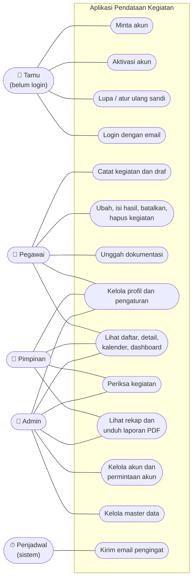

# 1. Use Case Diagram

Sesuai **Subbab 4.7.1 (Gambar 4.2, Tabel 4.7, dan Tabel 4.8)** Laporan KP. Mermaid belum punya diagram use case bawaan, jadi aktor digambar sebagai simpul di kiri dan use case sebagai simpul membulat di dalam batas sistem.

Hak akses ditegakkan di backend pada setiap permintaan: **Pegawai** adalah satu-satunya peran yang mencatat, mengubah, membatalkan, dan menghapus kegiatan miliknya serta melihat kegiatan bidangnya; **Pimpinan** melihat seluruh dinas dan memeriksa kegiatan tanpa mengubah data kegiatan; **Admin** memiliki akses Pimpinan ditambah pengelolaan akun, permintaan akun, dan master data (tanpa mencatat atau mengubah kegiatan). Kegiatan di luar lingkup baca dijawab `404`.

## Definisi Aktor (Tabel 4.7 Laporan KP)

| No | Aktor | Keterangan |
| --- | --- | --- |
| 1 | **Tamu** | Pengguna yang belum login. Tamu dapat masuk, meminta akun, mengaktivasi akun, dan mengatur ulang kata sandi. |
| 2 | **Pegawai** | Mencatat, mengubah, membatalkan, dan menghapus kegiatan miliknya, mengunggah dokumentasi, serta melihat kegiatan bidangnya. |
| 3 | **Pimpinan** | Melihat kegiatan seluruh dinas, rekap, dan laporan, serta memeriksa kegiatan. |
| 4 | **Admin** | Memiliki akses pimpinan ditambah pengelolaan akun, permintaan akun, dan master data. |
| 5 | **Penjadwal** | Proses otomatis di server yang mengirim email pengingat setiap 15 menit. |

## Definisi Use Case (Tabel 4.8 Laporan KP)

| No | Use Case | Keterangan |
| --- | --- | --- |
| 1 | **Minta akun** | Fungsi bagi tamu untuk mengajukan akun kepada admin melalui halaman login. |
| 2 | **Aktivasi akun** | Fungsi bagi pemilik akun untuk membuat kata sandi pertama melalui tautan yang dikirim ke email. |
| 3 | **Lupa / atur ulang sandi** | Fungsi untuk meminta tautan atur ulang kata sandi yang berlaku satu jam. |
| 4 | **Login dengan email** | Fungsi untuk masuk ke aplikasi menggunakan email dan kata sandi. |
| 5 | **Catat kegiatan dan draf** | Fungsi bagi pegawai untuk mencatat kegiatan baru atau menyimpannya sebagai draf. |
| 6 | **Ubah, isi hasil, batalkan, hapus kegiatan** | Fungsi bagi pegawai untuk mengelola kegiatan miliknya. |
| 7 | **Unggah dokumentasi** | Fungsi untuk mengunggah foto atau PDF dokumentasi kegiatan. |
| 8 | **Kelola profil dan pengaturan** | Fungsi untuk mengubah kontak, foto profil, kata sandi, sesi aktif, dan preferensi. |
| 9 | **Lihat daftar, detail, kalender, dashboard** | Fungsi untuk melihat kegiatan sesuai lingkup baca pengguna. |
| 10 | **Periksa kegiatan** | Fungsi bagi pimpinan dan admin untuk menandai kegiatan yang perlu perbaikan. |
| 11 | **Lihat rekap dan unduh laporan PDF** | Fungsi untuk melihat rekap kegiatan dan mengunduh laporan berkop dinas. |
| 12 | **Kelola akun dan permintaan akun** | Fungsi bagi admin untuk membuat, mengundang, dan menonaktifkan akun serta meninjau permintaan akun. |
| 13 | **Kelola master data** | Fungsi bagi admin untuk mengelola pegawai, bidang, sub bidang, dan jenis kegiatan. |
| 14 | **Kirim email pengingat** | Fungsi otomatis penjadwal untuk mengirim pengingat H-1 dan pengingat dokumentasi. |
