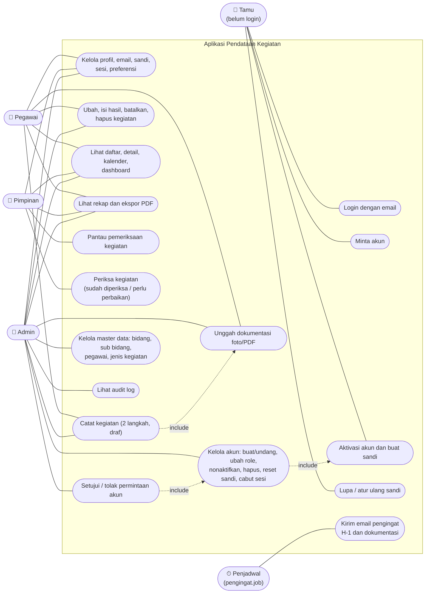

# 1. Use case

Mermaid belum punya diagram use case bawaan, jadi aktor digambar sebagai simpul di kiri dan use case sebagai simpul membulat di dalam batas sistem.

Hak akses ditegakkan di backend pada setiap permintaan: Pegawai melihat kegiatan bidangnya dan mengubah kegiatan miliknya, Pimpinan melihat seluruh dinas tanpa mengubah data, Admin mengelola semuanya. Kegiatan di luar lingkup dijawab 404.

## Ringkasan per aktor

| Aktor | Use case utama |
| --- | --- |
| Tamu | Login, minta akun, aktivasi lewat tautan email, lupa sandi |
| Pegawai | Catat dan ubah kegiatan miliknya, unggah dokumentasi, lihat kegiatan bidangnya, rekap, Pengaturan |
| Pimpinan | Lihat seluruh dinas (dashboard, kalender, rekap, ekspor), pantau dan periksa kegiatan, tanpa mengubah data kegiatan |
| Admin | Semua yang dilakukan Pegawai untuk seluruh dinas, ditambah akun, permintaan akun, master data, dan audit log |
| Penjadwal | Setiap 15 menit mengirim pengingat kegiatan H-1 dan pengingat dokumentasi bagi kegiatan yang sudah selesai |
