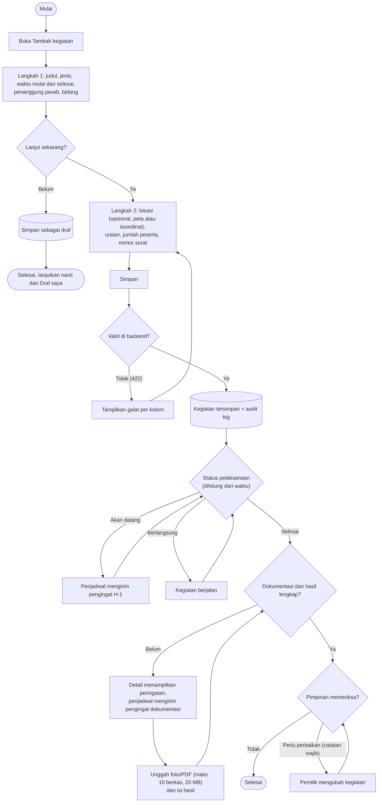
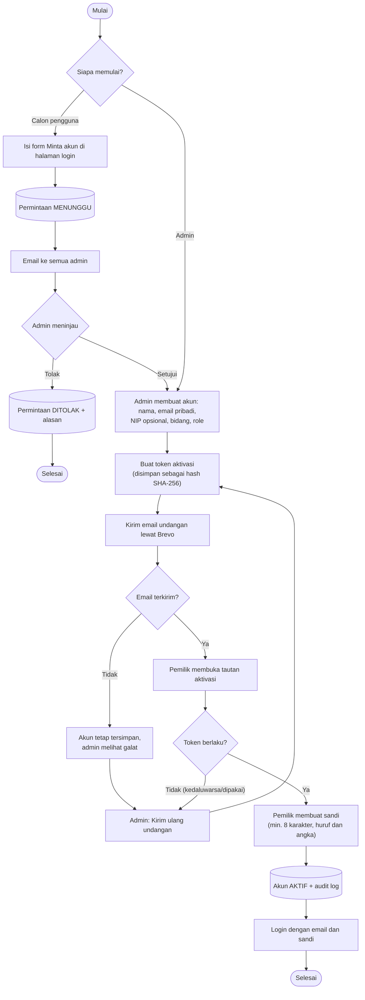

# 2. Activity

## 2.1 Mencatat kegiatan sampai dokumentasi

Kegiatan dicatat dalam dua langkah. Isian yang belum selesai bisa disimpan sebagai draf. Dokumentasi dan hasil dilengkapi setelah kegiatan berlangsung; status pelaksanaan dihitung otomatis dari waktu.

Kegiatan yang tidak jadi dilaksanakan dibatalkan (alasan wajib, tetap tercatat sebagai *Dibatalkan*). Menghapus kegiatan mengeluarkannya dari daftar dan rekap.

## 2.2 Akun: dari permintaan sampai aktif

Tidak ada pendaftaran mandiri. Akun dibuat admin, baik langsung maupun dari permintaan akun, lalu pemiliknya membuat sandi sendiri lewat tautan email.

