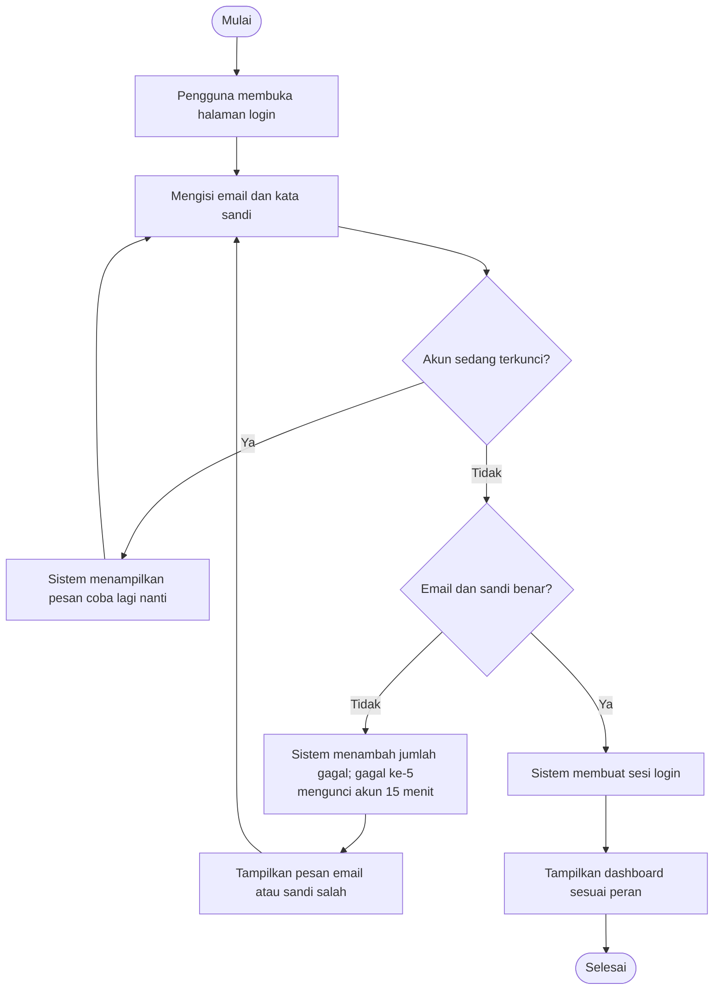
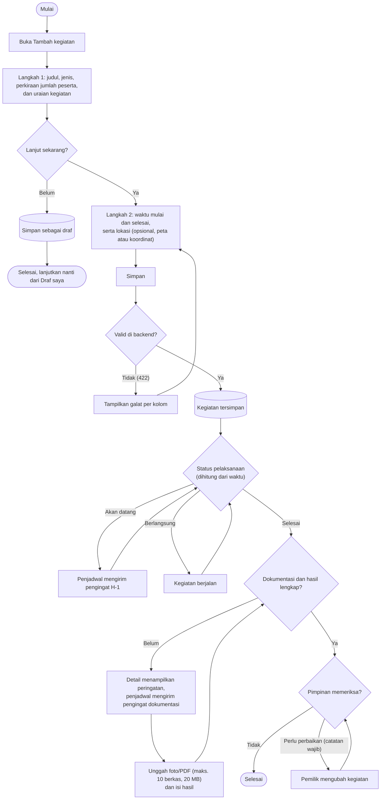
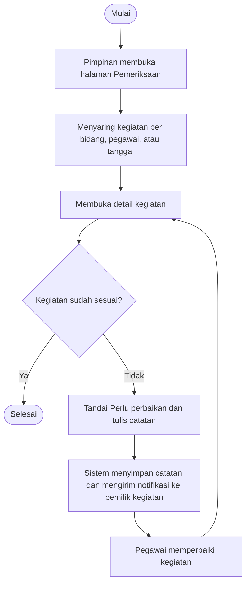
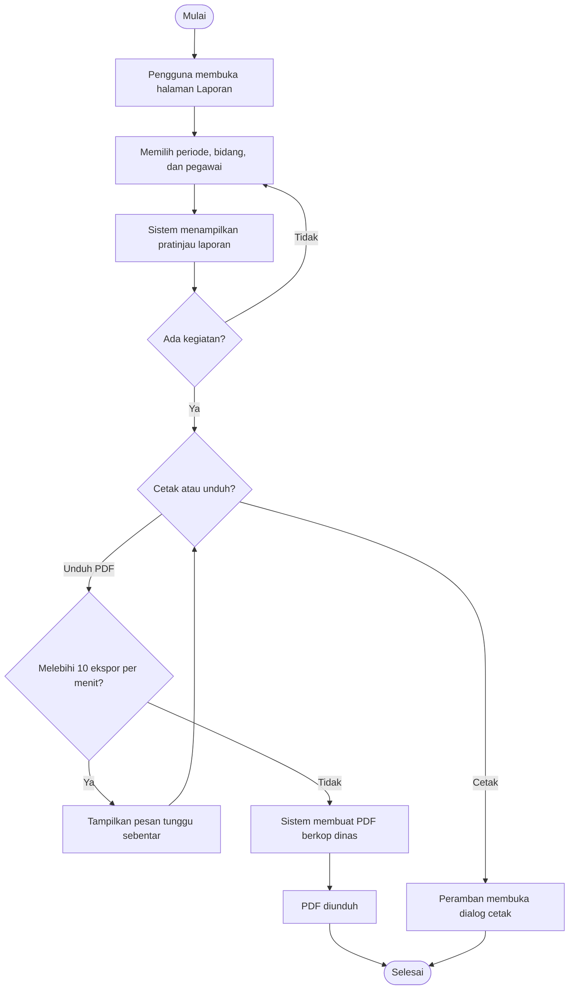

# 2. Activity Diagram

Sesuai **Subbab 4.7.2 (Gambar 4.3 s.d. Gambar 4.6)** Laporan KP.

## 2.1 Activity Diagram Login

Menggambarkan proses pengguna masuk ke aplikasi, termasuk penguncian akun selama 15 menit setelah lima kali salah kata sandi (`Gambar 4.3`).

## 2.2 Activity Diagram Mencatat Kegiatan sampai Dokumentasi

Kegiatan dicatat dalam dua langkah. Isian yang belum selesai bisa disimpan sebagai draf. Dokumentasi dan hasil dilengkapi setelah kegiatan berlangsung; status pelaksanaan dihitung otomatis dari waktu (`Gambar 4.4`).

Kegiatan yang tidak jadi dilaksanakan dibatalkan (alasan wajib, tetap tercatat sebagai *Dibatalkan*). Menghapus kegiatan mengeluarkannya dari daftar dan rekap.

## 2.3 Activity Diagram Memeriksa Kegiatan

Menggambarkan proses pimpinan (atau admin) memeriksa kegiatan. Kegiatan yang ditandai *Perlu perbaikan* memicu notifikasi kepada pemilik kegiatan (`Gambar 4.5`).

## 2.4 Activity Diagram Membuat Laporan PDF

Menggambarkan proses mencetak atau mengunduh laporan PDF berkop dinas berdasarkan periode, bidang, dan pegawai yang dipilih (`Gambar 4.6`).

