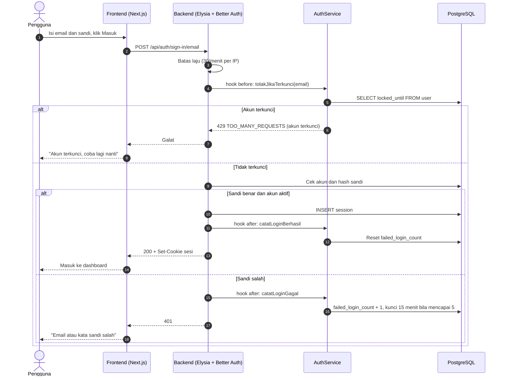
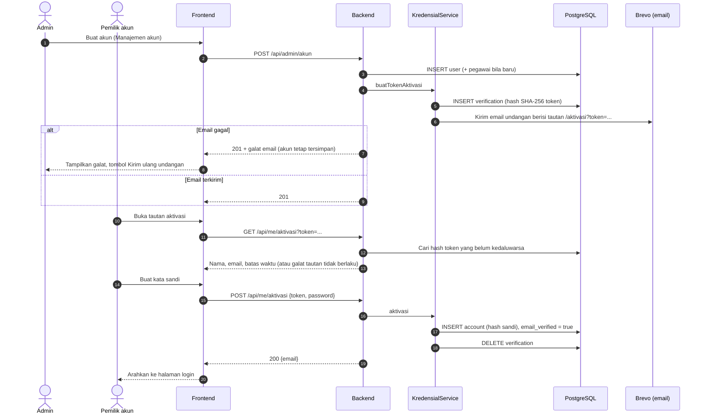
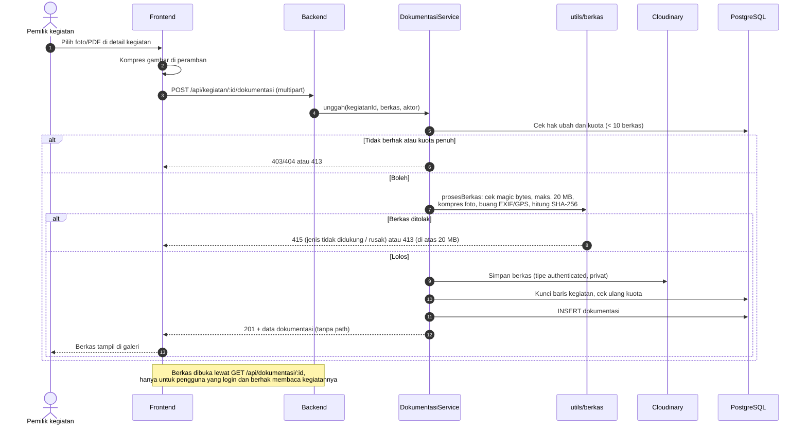

# 3. Sequence

Frontend dan backend berbagi satu origin: Next.js meneruskan `/api/*` ke backend, sehingga cookie sesi milik domain frontend.

## 3.1 Login dengan penguncian akun

Login ditangani Better Auth (`POST /api/auth/sign-in/email`). Hook di `apps/api/src/lib/auth.ts` menolak akun yang terkunci sebelum sandi dicek, lalu mencatat hasilnya: lima kali salah mengunci akun selama 15 menit. Batas laju 30 percobaan per menit per IP.

## 3.2 Aktivasi akun lewat email

## 3.3 Unggah dokumentasi

Kuota dicek sebelum dan sesudah berkas diproses (di dalam kunci transaksi), sehingga dua unggahan bersamaan tidak melewati batas 10 berkas.

