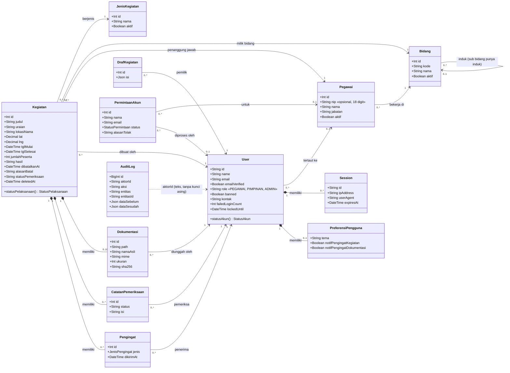
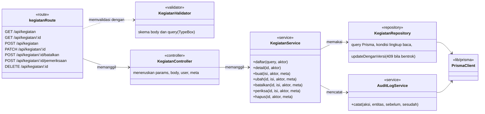

# 4. Class

## 4.1 Kelas domain

Diturunkan dari model Prisma. Atribut teknis (`createdAt`, `updatedAt`, token Better Auth) tidak ditulis agar diagram tetap terbaca; daftar kolom lengkap ada di [ERD](05-erd.md).

## 4.2 Lapisan backend

Setiap fitur di `apps/api/src` mengikuti pola yang sama. Contoh untuk kegiatan:

| Lapisan | Tanggung jawab | Contoh berkas |
| --- | --- | --- |
| Route | Alamat, metode HTTP, role yang diizinkan, validator | `routes/kegiatan.route.ts` |
| Controller | Mengambil params, body, pengguna, dan meta permintaan | `controllers/kegiatan.controller.ts` |
| Service | Aturan bisnis, hak akses, transaksi, audit log | `services/kegiatan.service.ts` |
| Repository | Query Prisma saja | `repositories/kegiatan.repository.ts` |
