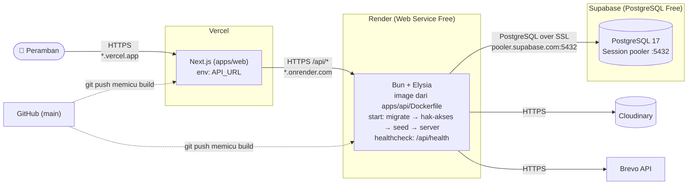

# 4. Deployment Diagram

Sesuai **Subbab 4.7.4 (Gambar 4.10)** Laporan KP. Langkah pemasangannya ada di [README utama](../../README.md).

## Pemasangan di Render, Supabase, dan Vercel

| Simpul | Isi |
| --- | --- |
| Vercel | Frontend Next.js. Satu-satunya variabel: `API_URL` (alamat Render) |
| Render backend | Container dari `apps/api/Dockerfile`. Setiap menyala menjalankan migrasi, pengaturan hak akses DB, seed, lalu server pada `PORT` (3001) |
| Supabase Postgres | Database PostgreSQL terkelola gratis, diakses melalui Session pooler (port `5432`, mendukung IPv4) |
| Cloudinary | Foto dan PDF, disimpan privat dan hanya dibuka lewat backend |
| Brevo | Email lewat API (tidak bergantung pada port SMTP) |
