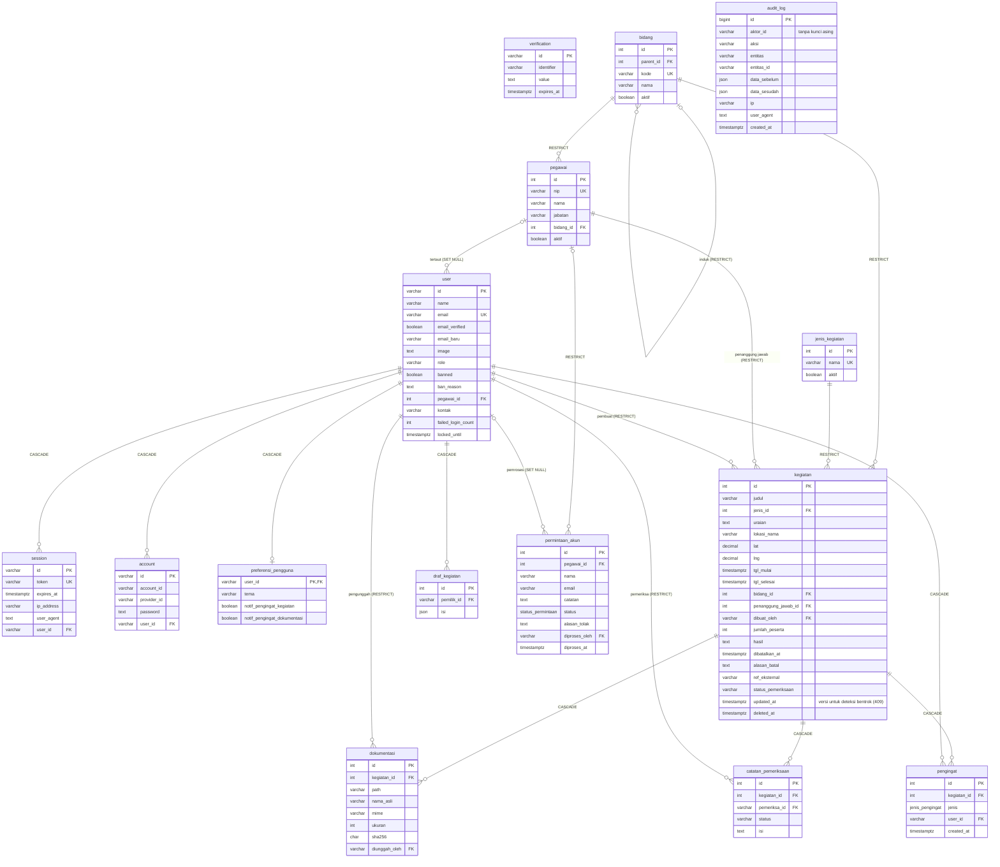

# 5. ERD

Nama tabel dan kolom memakai snake_case seperti di PostgreSQL. Sumber: `apps/api/prisma/schema.prisma`.

## Catatan

- **Status akun tidak disimpan**, melainkan diturunkan: belum punya baris `account` berarti *Menunggu aktivasi*, `banned = true` berarti *Nonaktif*, selain itu *Aktif*.
- **Token** aktivasi, atur ulang sandi, dan ganti email disimpan di `verification` sebagai hash SHA-256, bukan teks asli.
- **Data master** (`bidang`, `pegawai`, `jenis_kegiatan`) tidak dihapus, cukup dinonaktifkan lewat kolom `aktif`.
- **Tabel `bidang`** berisi bidang dan sub bidang. Tingkatnya ditentukan `parent_id`: kosong berarti bidang, terisi berarti sub bidang (maksimal dua tingkat). Tabel ini dulu bernama `unit_kerja` (migrasi `2_ganti_nama_unit_kerja_jadi_bidang`, data tetap utuh), dan tabel `jenis_unit` sudah dihapus (migrasi `3_hapus_jenis_unit`).
- **Kegiatan dihapus secara lunak** (`deleted_at`), sehingga riwayat audit tetap merujuk ke data yang ada.
- **`audit_log` append-only.** `aktor_id` sengaja tanpa kunci asing agar riwayat tetap utuh setelah akun dihapus.
- Aturan `RESTRICT` pada pembuat kegiatan, pengunggah dokumentasi, dan pemeriksa adalah alasan akun yang sudah meninggalkan data kegiatan tidak bisa dihapus (cukup dinonaktifkan).
- `pengingat` unik per (`kegiatan_id`, `jenis`, `user_id`), sehingga setiap pengingat hanya terkirim sekali.
