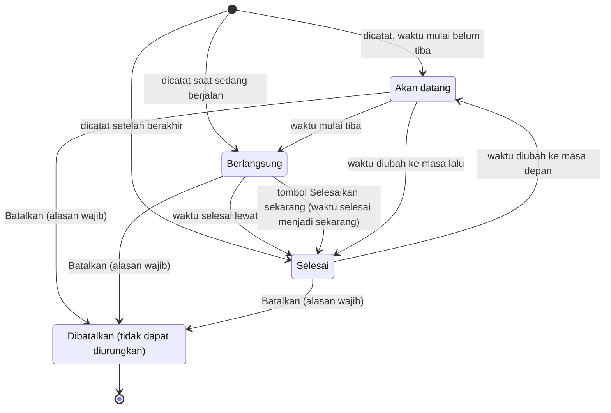
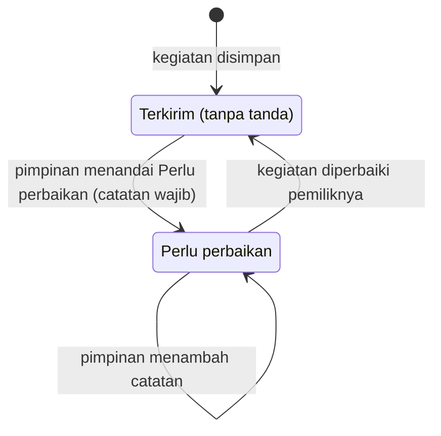
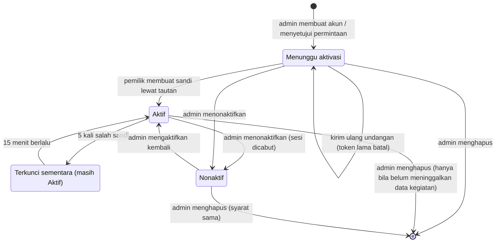
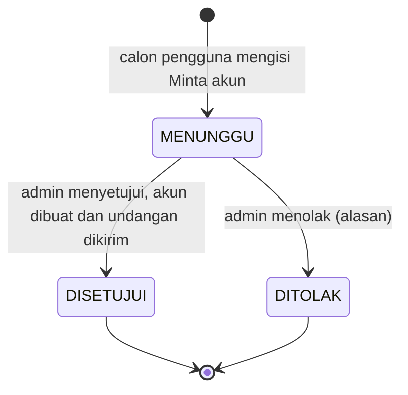

# 6. State

## 6.1 Status pelaksanaan kegiatan

Tidak disimpan di database; dihitung setiap kali dibaca dari `tgl_mulai`, `tgl_selesai`, `dibatalkan_at`, dan waktu sekarang (`hitungStatus`). Karena itu status tidak bisa dipilih manual: untuk membuat kegiatan langsung *Selesai*, ubah waktu selesainya.

## 6.2 Status pemeriksaan kegiatan

Disimpan di `kegiatan.status_pemeriksaan`. Pimpinan hanya menandai kegiatan yang perlu perbaikan; kegiatan yang tidak ditandai tetap sah. `terkirim` adalah keadaan biasa dan tidak ditampilkan. Setiap perubahan kegiatan oleh pemiliknya mengembalikan status ke `terkirim`.

## 6.3 Status akun

Diturunkan dari data (lihat catatan di [ERD](05-erd.md)), bukan kolom tersendiri.

## 6.4 Status permintaan akun

