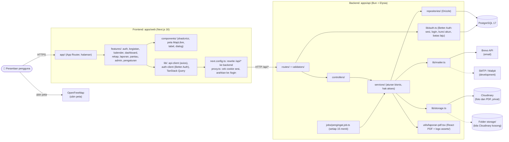

# 7. Component

| Komponen | Peran |
| --- | --- |
| Rewrite `/api/*` | UI dan API tampil di satu origin, sehingga cookie sesi milik domain frontend dan tidak ada masalah CORS |
| Better Auth | Login email dan sandi, sesi di database, penguncian akun lewat hook, batas laju per IP |
| Service | Satu-satunya tempat aturan bisnis dan pemeriksaan hak akses |
| Storage | Cloudinary bila `CLOUDINARY_URL` diisi, selain itu folder lokal `STORAGE_DIR` |
| Mailer | API Brevo bila `BREVO_API_KEY` diisi, selain itu SMTP |
| Penjadwal | Berjalan di dalam proses backend; tidak dijalankan saat pengujian |
