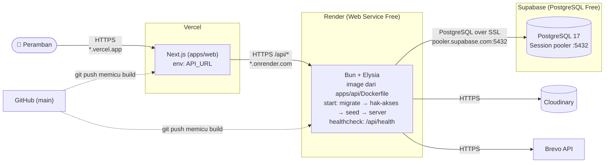
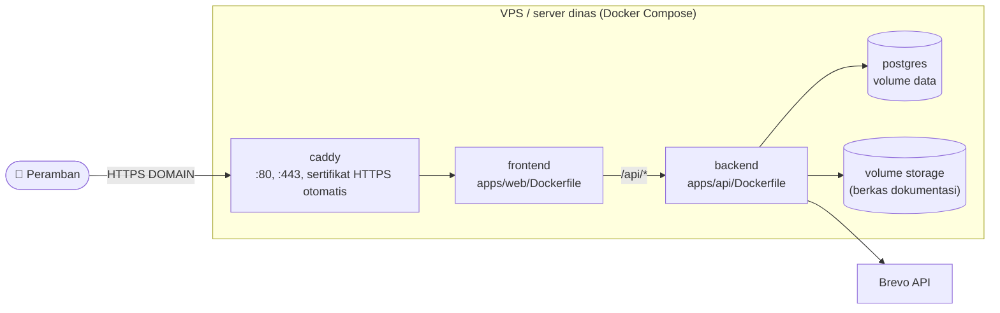

# 8. Deployment

Langkah pemasangannya ada di [README utama](../../README.md).

## 8.1 Render + Supabase + Vercel (yang dipakai sekarang)

| Simpul | Isi |
| --- | --- |
| Vercel | Frontend Next.js. Satu-satunya variabel: `API_URL` (alamat Render) |
| Render backend | Container dari `apps/api/Dockerfile`. Setiap menyala menjalankan migrasi, pengaturan hak akses DB, seed, lalu server pada `PORT` (3001) |
| Supabase Postgres | Database PostgreSQL terkelola gratis, diakses melalui Session pooler (port `5432`, mendukung IPv4) |
| Cloudinary | Foto dan PDF, disimpan privat dan hanya dibuka lewat backend |
| Brevo | Email lewat API (tidak bergantung pada port SMTP) |

## 8.2 Alternatif: VPS dengan Docker Compose

Satu `docker compose` di server sendiri (mis. server Diskominfo). Hanya Caddy yang membuka port ke luar.

Konfigurasi ada di `docker-compose.yml`, `Caddyfile`, dan `.env` di root (dibuat dari `docker.env.example`). Jangan menjalankan `docker compose down -v`, karena perintah itu menghapus volume data.
