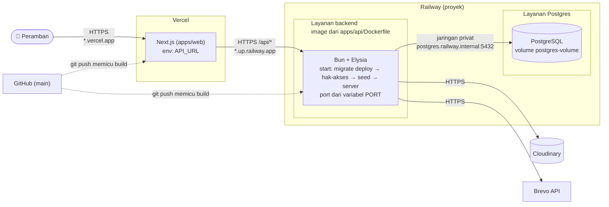
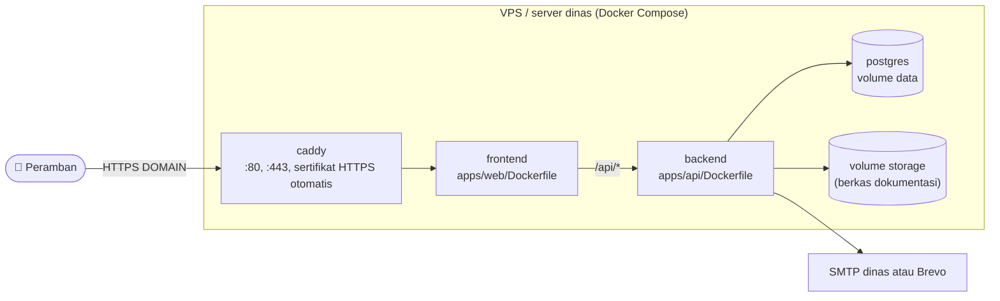

# 8. Deployment

Langkah pemasangannya ada di [README utama](../../README.md).

## 8.1 Railway + Vercel (yang dipakai sekarang)

| Simpul | Isi |
| --- | --- |
| Vercel | Frontend Next.js. Satu-satunya variabel: `API_URL` (alamat Railway) |
| Railway backend | Container dari Dockerfile. Setiap menyala menjalankan migrasi, pengaturan hak akses DB, seed, lalu server. Port domain publik harus sama dengan `PORT` yang dipakai server |
| Railway Postgres | Database dengan volume tersendiri, sehingga data tetap ada saat backend dibangun ulang |
| Cloudinary | Foto dan PDF, disimpan privat dan hanya dibuka lewat backend |
| Brevo | Email lewat API (Railway memblokir SMTP) |

## 8.2 Alternatif: VPS dengan Docker Compose

Satu `docker compose` di server sendiri (mis. server Diskominfo). Hanya Caddy yang membuka port ke luar.

Konfigurasi ada di `docker-compose.yml`, `Caddyfile`, dan `.env` di root (dibuat dari `docker.env.example`). Jangan menjalankan `docker compose down -v`, karena perintah itu menghapus volume data.
